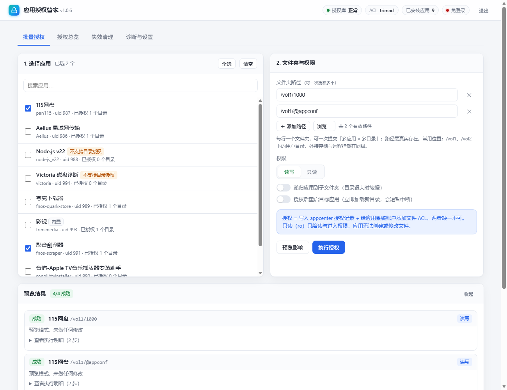

# 应用授权管家（appauthz）

[](https://github.com/liangpangzhi/fnos-appauthz/releases/latest)
[](https://github.com/liangpangzhi/fnos-appauthz/releases)
[](LICENSE)

飞牛 fnOS 的 `.fpk` 原生应用（Python + 原生网页，无 Docker、无第三方依赖），
用来**统一批量管理"已安装应用可访问哪些文件夹、是读还是读写"**。

fnOS 默认只能一个个应用、一个个目录地去点：
`系统设置 → 应用 → 某个应用 → 允许访问以下文件夹 → 添加 → 选权限`。
装十个应用、配五个目录，就是五十次重复劳动。本应用把它变成一次操作。



**下载**：[`appauthz-1.0.6-x86.fpk`](https://github.com/liangpangzhi/fnos-appauthz/releases/download/v1.0.6/appauthz-1.0.6-x86.fpk)（120 KB，无需 Docker）
→ 应用中心 → 手动安装 → 选择该文件。

---

## 一、能做什么

| 场景 | 说明 |
| --- | --- |
| **多应用 × 多目录批量授权** | 勾选 5 个应用 + 选 1 个文件夹 + 选读写/只读 → 一次点完 |
| **授权复制** | 把「影视」已经配好的 6 个目录一键复制给「Jellyfin」「Emby」 |
| **授权总览** | 一屏看清哪些应用能访问哪些目录、什么权限，逐条撤销 |
| **实测校验** | 用应用自己的系统账户真实执行 `test -r/-w/-x`，验证权限到底生效没有 |
| **失效路径清理** | 卷/网盘卸载后残留的"死授权"会让应用中心刷 `trim access stat error`，可一键清理 |
| **诊断面板** | 数据库结构、ACL 工具、perm 取值、执行日志、参数调整都在这里 |

---

## 二、安装

1. 构建（或直接使用 `dist/appauthz-1.0.6-x86.fpk`）：

   ```bash
   python build.py                  # x86
   python build.py --platform arm   # ARM 机型
   ```

   产物命名遵循 fnOS 规范：`dist/<appname>-<version>-<arch>.fpk`。

2. 打开 fnOS：**应用中心 → 手动安装 → 选择 fpk 文件**。

   也可以在 NAS 上命令行安装（`-e` 对应向导输入项）：

   ```bash
   printf 'wizard_admin_password=你的密码\nwizard_admin_password2=你的密码\nwizard_port=18080\n' > /tmp/appauthz.env
   sudo appcenter-cli install-fpk /tmp/appauthz-1.0.6-x86.fpk -e /tmp/appauthz.env -v 1
   ```

3. 安装向导会让你设置：
   - **管理密码**（≥6 位）——本应用以 root 运行，必须有一道自己的门；
   - **端口**（默认 `18080`，冲突可改成 18000–19999 间的空闲端口）。

4. 安装完成后，桌面出现「应用授权管家」图标，或直接访问 `http://<NAS地址>:18080/`。

   > 这一条要能成立，浏览器必须能直达该端口。若 NAS 前面有 NAT / 端口映射
   > （例如本机 QEMU 测试机只映射了 5666、2222），需要把 18080 也映射出去，
   > 否则点图标只会得到“无法访问 / 拒绝访问”。QEMU 测试机可以热加，不用重启：
   >
   > ```bash
   > python scripts/open_port.py            # 给运行中的虚拟机补 18080 转发
   > python scripts/open_port.py --list     # 查看当前所有转发
   > ```

> 端口改了以后，桌面图标的端口也会被自动改写；若你手动改过端口，
> 需在应用中心停止 → 启动一次（`ui/config` 里的入口端口也要一致）。

---

## 三、使用

### 批量授权

1. **选择应用**：左侧勾选，支持搜索、全选。
2. **文件夹路径**：**可以一次填多个**——点「＋ 添加路径」加一行，或逐行点「浏览…」在存储空间里选
   （只允许配置过的根目录，默认 `/vol`，它代表所有存储卷 `/vol1`、`/vol2`、`/vol00`…）。
   每行一个文件夹，提交时按「应用数 × 目录数」逐条执行，例如 3 个应用 + 4 个目录 = 12 条授权一次跑完。
3. **权限**：`读写` 或 `只读`。
4. 可选 **递归应用到子文件夹**（目录很大时较慢）、**授权后重启目标应用**（让新目录立即生效）。
5. 先点「预览影响」看将要执行的命令与 SQL（矩阵里每一条都会列出），确认无误再「执行授权」。

每次授权会：

- 给应用的系统账户（如 `trim-media`、`qbittorrent`）在目标文件夹上添加 ACL 条目；
- 往 `appcenter` 数据库写入两条关联记录，使**系统设置界面**也能看到这次授权。

### 授权总览

按应用分组列出全部授权，逐条「校验 / 撤销」，也可以「全部撤销」或「复制授权到…」。

### 失效清理

扫描两张授权表中指向已不存在路径（或已不存在账户）的记录，勾选后清理。
**只删数据库记录，不碰任何文件。**

### 诊断与设置

- 运行环境、ACL 工具、数据库结构、perm 取值统计、存储卷容量；
- 参数：ACL 工具（auto/trimacl/setfacl）、读写与只读对应的 perm 值、允许的根目录、端口；
- **免密码登录**开关（见下）；
- 管理密码、查看运行日志。

### 免密码登录（可选）

不想每次输密码，可以在「诊断与设置」里打开 **免密码登录**：打开界面直接进，不再要密码。
密码本身会保留，随时把开关关掉就恢复需要密码。

命令行也行（立刻生效，不用重启应用）：

```bash
cd /var/apps/appauthz/target/server
./manage.py auth --mode off     # 免登录
./manage.py auth --mode on      # 恢复要密码
./manage.py auth --mode show    # 看当前状态
```

> 注意：本应用以 **root** 运行，免登录等于“谁能访问这个端口，谁就能改授权”。
> 只在可信内网、或端口仅本机可访问时使用；NAS 暴露公网时请保持密码开启。

---

## 四、技术原理

### 1. fpk 结构（与官方 fnpack 产物一致）

```
.fpk = gzip(tar)   USTAR，成员按名称不区分大小写排序
├── app.tgz        安装到 $TRIM_APPDEST 的内容（自身 gzip(tar)，不含 app/ 前缀）
├── cmd/           main / install_init / install_callback / upgrade_* / uninstall_* / config_*
├── config/        privilege（run-as root）、resource
├── ICON.PNG  ICON_256.PNG
├── LICENSE
├── manifest       INI，末尾 checksum = md5(app.tgz)，行尾 CRLF
└── wizard/        install / uninstall 向导
```

细节（`tools/pack_fpk.py` 已实现）：目录项 0777、文件 0666、uid=gid=0、
目录名不带结尾斜杠、`devmajor/devminor` 写 `0000000\0`、只有两个结束零块、
gzip 头 `FLG=0 MTIME=0 XFL=0 OS=255`、`cmd/` 脚本一律 LF。

### 2. fnOS 的应用授权存在哪

两处，缺一不可：

| 层 | 位置 | 作用 |
| --- | --- | --- |
| 数据库 | PostgreSQL 库 `appcenter`：<br>`app_authorization_path(app_id, path)`<br>`authorization_path(path, user_group_id, perm, type='appuser')` | 系统设置界面显示、应用启动时注入 `TRIM_DATA_ACCESSIBLE_PATHS` |
| 文件系统 | 目录上的 ACL 条目（应用账户 uid） | 进程实际能不能读写 |

- `user_group_id` 就是应用系统账户的 uid（实测 `影视`=`trim-media`=993）；
- `perm` 常见取值：`6` = 读写、`4` = 只读（可在诊断页按实际情况调整）；
- 真实表结构还多一列 `trimacl_perm`（bigint，系统自身写入的 rw 记录为 `0`），本应用按同样行为写入；
- fnOS 1.2 起文件权限改用 Windows ACL 体系，工具是 **`/usr/trim/bin/trimacl`（不在 PATH 中）**，旧版为 `setfacl`；
- `trimacl` 的 ACE 带 `sfd` 继承标志，**自动作用于子文件与子目录，不需要 `-R`（也不支持 `-R`）**；
- 撤销必须按 ACE 序号：`trimacl -x2 <path>`，不能按 uid 删除。

程序会**在运行时探测** `information_schema` 自动定位这两张表，因此系统小版本变化
（表名/列名微调）也能适配；如果探测不到，诊断页会明确报出来，且只做 ACL 不动数据库。

### 3. 一次授权做了什么

```
/usr/trim/bin/trimacl -m a:u:<uid>:rwxpdDaAeEc:sfd <path>   # 读写
/usr/trim/bin/trimacl -m a:u:<uid>:rx:sfd          <path>   # 只读
# 撤销：trimacl -x<ACE 序号> <path>（序号从 `trimacl <path>` 的输出里取）
# 旧系统无 trimacl 时降级：setfacl -m u:<uid>:rwx <path> + 默认 ACL d:u:<uid>:rwx

BEGIN;
INSERT INTO app_authorization_path (app_id, path, created_at, updated_at)
  SELECT ... WHERE NOT EXISTS (...);
INSERT INTO authorization_path (path, user_group_id, perm, type, created_at, updated_at)
  SELECT ... WHERE NOT EXISTS (...);
UPDATE authorization_path SET perm = <perm> WHERE ... AND perm <> <perm>;
COMMIT;
```

- 写入前自动 `pg_dump --data-only --column-inserts` 备份这两张表到
  `<PKGVAR>/backup/`（保留最近 40 份）；
- SQL 全部在事务中执行；路径含引号/换行的输入会被直接拒绝（防注入）；
- 所有操作写入 `audit.log`，可在诊断页查看。

---

## 五、安全说明

- 进程以 **root** 运行（修改其他应用的 ACL 与数据库必须有此权限），
  因此入口设了独立管理密码（PBKDF2-SHA256，20 万次迭代；会话为 HMAC 签名 Cookie，12 小时）。
- 连续 5 次密码错误锁定 60 秒；跨站 POST 会被 `Origin` 校验拒绝（另有 SameSite=Lax）。
- **免密码登录默认关闭**。开启后不再校验密码，顶栏会挂红色「免登录」标记作为提醒；
  忘记密码时可 `manage.py auth --mode off` 临时进入，再从界面重设密码。
- 只能操作**配置过的根目录**内的、**真实存在的目录**；符号链接逃逸会被 `realpath` 拦下；
  根目录本身（`/`）、`/etc`、`/usr` 等一律不可操作。
- 桌面入口 `allUsers: false`，普通账号看不到图标。
- 本应用不会读取、上传任何文件内容，只改权限。

---

## 六、故障排查

| 现象 | 处理 |
| --- | --- |
| 授权成功，但目标应用仍读不到 | 打开「授权后重启目标应用」，或在应用中心手动重启该应用（目录列表是进程启动时注入的） |
| 授权成功，但「系统设置 → 应用」里看不到 | `app_id` 没找到（诊断页会标 `无 app_id`）：该应用可能不是通过应用中心安装的，此时只有 ACL 生效 |
| 界面里权限显示 `other(8)` 之类 | `perm` 映射不同：诊断页的「perm 取值统计」能看出真实取值，改「读写/只读对应的 perm 值」即可 |
| 撤销后应用还能读 | ACL 撤销失败（`trimacl -x` 报错）。诊断页能看到具体命令，可 SSH 手动执行；数据库记录已删，界面不再显示 |
| 日志刷 `trim access stat error` | 用「失效清理」清掉指向已消失路径的授权记录 |
| 端口冲突起不来 | 应用中心 → 设置里改端口，或改 `<PKGETC>/settings.json` 的 `port` 后重启应用 |
| 忘记管理密码 | 临时免登录进去：`manage.py auth --mode off` → 界面里重设密码 → `manage.py auth --mode on`；或直接 `manage.py reset-password --password '新密码'` |
| 桌面图标空白/是灰块 | 图标文件名必须是 **`icon_64.png`**（下划线），由 `ui/config` 的 `images/icon_{0}.png` 拼出来；`icon-64.png`（连字符）系统找不到。本包已内置 16/24/32/48/64/72/96/128/256 全套 |
| 选了文件夹却提示“不在允许范围内” | 根目录设成了具体卷（如 `/vol1`）就会挡住别的卷。想放开全部存储卷，把「允许的根目录」写成 `/vol` |
| 点图标提示“无法访问 / 拒绝访问” | 第三方应用走独立端口，浏览器必须能直达 `NAS:18080`。若 NAS 前面有 NAT、端口映射或只放行了部分端口，把 **18080** 也映射出去；QEMU 虚拟机可用 `python scripts/open_port.py` 热加，不用重启 |

查看日志：`/var/apps/appauthz/var/appauthz.log`；备份：`/var/apps/appauthz/var/backup/`。

---

## 七、真机验证记录

在 fnOS 虚拟机（Debian 12 / kernel 6.18 / SSH 2222）上完成安装与端到端验收，
只读与读写两套用例各 **24/24 通过**，详情见 [`docs/安装测试报告.md`](docs/安装测试报告.md)。

几个容易踩的坑（都已处理）：

| 坑 | 说明 |
| --- | --- |
| 只报 `code 10111` | 多半是 `wizard` 解析失败。`initValue` 必须是**字符串**（`"false"` 不是 `false`）。用 `appcenter-cli install-local -d <解包目录>` 能看到具体报错 |
| `trimacl` 找不到 | 它在 `/usr/trim/bin`，不在 PATH 里；直接用 `which trimacl` 会误判为"没有，改用 setfacl" |
| 想递归授权 | `trimacl` 不支持 `-R`，但 `sfd` 继承已覆盖子项，无需递归 |
| 卸载失败 | 包内 `wizard/uninstall` 若有输入项，`appcenter-cli uninstall`（无任何参数）会拒绝卸载，提示去 Web UI |
| 同版本重装 | `install-fpk` 直接拒绝；用 `install-local` 或先卸载 |
| 桌面图标空白 | 图标名要 `icon_64.png` 这类下划线形式（参考系统自带应用 `trim.media/ui/images/`），`icon-64.png` 不认 |
| 想借 5666 反代 | `/usr/trim/nginx/conf/conf.d/` 有反篡改保护：写入的自定义 conf 在 `nginx -t` 时会被删除，别往这里加配置；第三方应用老实走独立端口 |

## 八、本地开发

```bash
# 不需要 fnOS：演示模式（不触碰任何系统资源，数据为内置样例）
python app/server/app.py --dest app --etc /tmp/aa/etc --var /tmp/aa/var --demo --port 18080 --no-auth

# 需要登录态时去掉 --no-auth，密码用下面命令初始化
wizard_admin_password=test123456 python app/server/manage.py bootstrap \
    --dest app --etc /tmp/aa/etc --var /tmp/aa/var
```

在真实 fnOS 上调试：

```bash
# 上传目录后本地安装
appcenter-cli install-local /path/to/appauthz
appcenter-cli list | start | stop
```

---

## 九、目录结构

```
appauthz/
├── manifest                 应用元信息
├── config/privilege         run-as root
├── config/resource          资源声明
├── cmd/                     9 个生命周期脚本
├── wizard/install|uninstall 向导
├── app/
│   ├── ui/config            桌面入口（iframe → 端口）
│   ├── ui/images/           64 / 256 图标
│   ├── server/
│   │   ├── app.py           HTTP 服务 + API（标准库 http.server，线程池）
│   │   ├── fnos.py          核心：应用枚举 / 数据库 / ACL / 校验 / 巡检
│   │   ├── common.py        配置、日志、口令、路径校验
│   │   ├── demo.py          演示后端
│   │   └── manage.py        bootstrap / reset-password
│   └── web/                 index.html + app.js + style.css（原生，无框架）
├── tools/pack_fpk.py        纯 Python fpk 打包器（无需 fnpack）
├── tools/make_icons.py      纯标准库图标生成
├── build.py                 一键构建
├── scripts/remote.py        远程操作助手（paramiko：run/sudo/push/pull/probe）
├── scripts/live_test.py     NAS 本机端到端验收脚本（24 项断言）
├── scripts/open_port.py     给 QEMU 测试机热加端口转发（QMP，不用重启）
├── scripts/ui_click_test.mjs 真实浏览器点击回归（CDP：弹窗选择 / 多路径预览）
├── scripts/tunnel.py        端口转发（机型允许时可用）
├── docs/                    截图 + 安装测试报告
└── dist/                    产物
```

---

## 十、免责

本程序会以 root 身份修改 `appcenter` 数据库与文件夹 ACL。所有写操作前都会备份、
并在事务中执行；但请仍在理解其行为后使用，重要数据建议另有备份。
